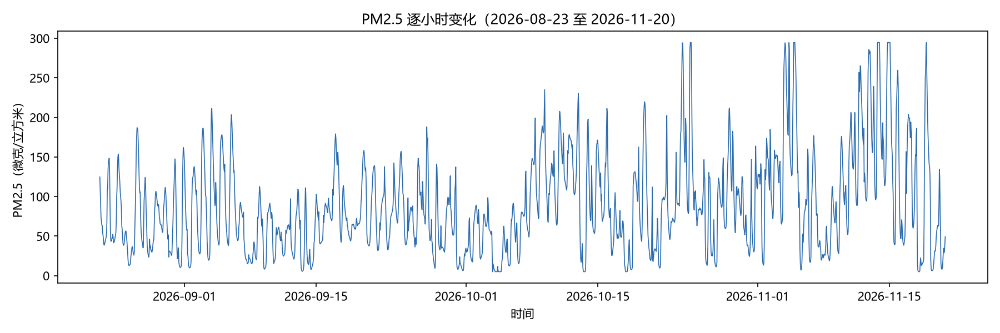
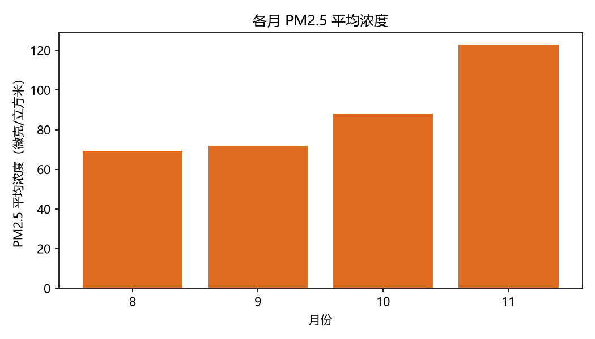
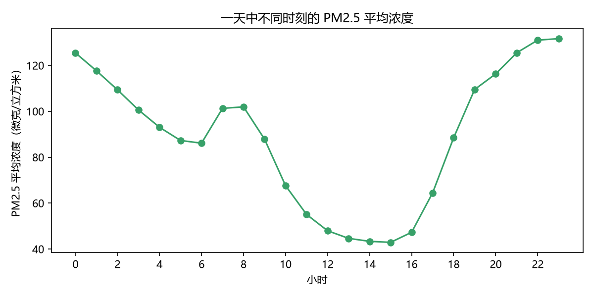
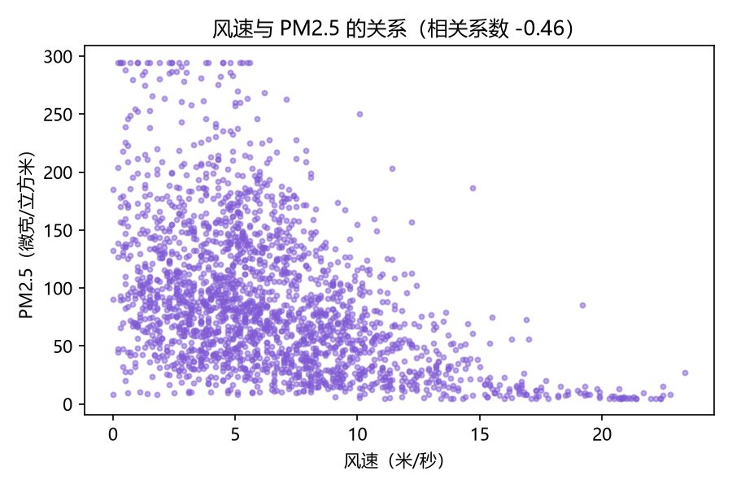

# 北京空气质量数据分析

对北京连续 90 天的逐小时空气质量与气象数据进行采集、清洗、统计分析和可视化，并自动生成分析报告。



## 项目概述

本项目基于 Open-Meteo 公开数据接口，实现了从数据获取到结论输出的自动化分析流程：

- **数据采集**：调用空气质量与历史气象接口，采集 2160 条逐小时数据；支持请求失败重试与备用接口切换。
- **数据清洗**：剔除 PM2.5 缺失值，对连续时间序列进行线性插值，去除负值，并按 1%–99% 分位截断极端值。
- **统计分析**：按月份、时段、工作日/周末分组聚合，计算 PM2.5 与气温、相对湿度、风速的皮尔逊相关系数。
- **可视化与报告**：使用 matplotlib 输出 4 张图表，并自动生成 Markdown 分析报告。

## 主要发现

- 90 天 PM2.5 平均浓度 **88.6 μg/m³**，最高 294.7（2026-10-24 20:00）。
- **随入冬明显上升**：8 月平均 69.2，11 月平均 122.9，约为 8 月的 **1.8 倍**。
- **夜间浓度最高**：23 点平均 131.7，凌晨 0 点 123.9；下午 14–15 点最低（约 43）。
- **风速影响明显**：PM2.5 与风速的相关系数为 **−0.46**（中等负相关）；与相对湿度 0.49，与气温 −0.30。
- 工作日平均 88.4，周末平均 89.0，两者几乎无差异。

## 数据与方法

- 数据来源：Open-Meteo 空气质量接口和历史气象接口（公开、免费、无需密钥）。
- 时间窗口：2026-08-23 至 2026-11-20。气象历史数据约有 5 天延迟，因此窗口截止到 5 天前，保证两类数据按时间对齐。
- 清洗：缺失值处理、线性插值、负值剔除、1%–99% 分位截断。
- 分析：月度、小时、工作日/周末分组统计，皮尔逊相关系数。
- 局限性：样本仅覆盖北京一个城市、90 天窗口；相关关系不等同于因果关系，结论不能直接外推到其他城市或季节。

## 快速开始

```bash
pip install -r requirements.txt
python analyze_air_quality.py
```

Windows 也可以直接双击 `run.bat`。

运行后会生成：

- `data/beijing_air_clean.csv`：清洗后的数据
- `charts/`：4 张图表
- [分析报告.md](分析报告.md)：自动生成的报告

## 项目结构

```
01-air-quality/
├── analyze_air_quality.py   # 采集、清洗、分析、可视化
├── run.bat                  # Windows 一键运行
├── requirements.txt         # 依赖列表
├── data/                    # 清洗后的数据
├── charts/                  # 4 张图表
└── 分析报告.md              # 自动生成的分析报告
```

## 技术栈

Python 3.12 · requests · pandas · matplotlib

## 图表







## 作者

张嘉硕 · GitHub：[zjsbig](https://github.com/zjsbig)
